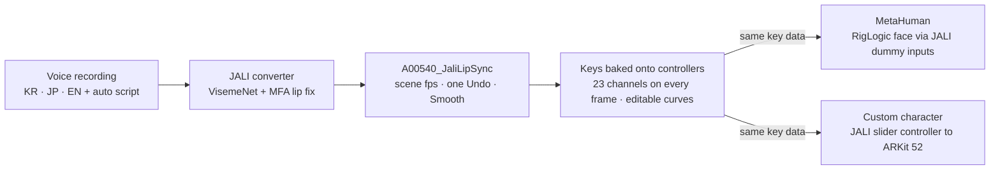

# JALI LipSync — 노션 소개 문구

> 2026-11-27 작성. 리깅 포트폴리오 노션의 JALI 툴 · 파이프라인 페이지용 소개 문구.
> 근거 자료: `D:\D__1010_PortFolio\00010_JALI_Brant` 씬 7개(mayapy 로 확인), `portfolio_KR.md` 1-7장.

## 헤드라인 (페이지 상단 콜아웃)

**음성 파일 하나로, 리그 컨트롤러에 직접 키가 박힌 립싱크를 — 한국어 · 일본어 · 영어, MetaHuman 과 커스텀 캐릭터 모두에.**

> `A00540_JaliLipSync` 는 VisemeNet 이 추론한 JALI 비짐을 블렌드셰이프나 메시 캐시가 아니라 **리그의 컨트롤러 채널에 프레임 단위 키프레임으로 베이크**합니다. 결과물은 애니메이터가 그래프 에디터에서 바로 다듬을 수 있는 일반 애니메이션 커브입니다.

짧은 버전 (한 줄 소개가 필요할 때):

- 오디오 → JALI 비짐 → 리그 컨트롤러 키. 같은 키 데이터가 MetaHuman 과 커스텀 ARKit 캐릭터를 함께 움직입니다.

## 메인 소개 문구

오디오 기반 립싱크 솔루션은 대부분 결과를 블렌드셰이프 값이나 메시 캐시로 내보냅니다. 보기에는 말하지만, 애니메이터가 향하면 손댈 수 있는 컨트롤러가 없습니다.

**JALI LipSync 파이프라인은 결과를 리그 컨트롤러에 키프레임으로 베이크합니다.** 음소 16개, 동시조음 5개, JALI 의 Jaw · Lip 축 2개, 총 23개 채널에 씬 fps 로 매 프레임 키가 들어갑니다. 결과는 손으로 잡은 애니메이션과 같은 형식이라, 그래프 에디터 편집 · 애니메이션 레이어 · 표정 덧그리기가 그대로 통합니다.

영상의 두 캐릭터는 **같은 키 데이터**로 움직입니다. 하나는 RigLogic 기반 MetaHuman 페이셜, 다른 하나는 ARKit 52 블렌드셰이프를 가진 커스텀 캐릭터입니다. 리그마다 키를 받는 입력부를 같은 규격(같은 이름 · 0~1 단위)으로 맞춰, 툴 하나가 어느 리그에나 같은 방식으로 키를 넣습니다.

한 명의 화자(Brant)가 녹음한 한국어 · 일본어 · 영어 대사를 두 캐릭터에 적용했습니다. 언어마다 다시 키를 잡지 않고, 같은 파이프라인을 한 번 더 돌릴 뿐입니다.

## 파이프라인

음성 파일에서 컨트롤러 키까지 사람이 손으로 키를 잡는 단계가 없습니다. 노션에서는 아래 mermaid 블록을 코드 블록(언어: Mermaid)으로 붙이면 그림으로 보입니다.

1. **음성** — 한국어 · 일본어 · 영어 wav. 대본은 로컬 STT 로 자동 생성.
2. **변환** — VisemeNet 이 JALI 비짐을 추론하고, MFA 대본 정렬로 입술 닫힘을 보정.
3. **키 베이크** — `A00540_JaliLipSync` 가 씬 fps 로 23채널을 컨트롤러에 키. 대사가 많으면 `A00560_JaliBatch` 가 클립 파일로 한 번에.
4. **리그 구동** — 같은 키가 MetaHuman 과 커스텀 캐릭터를 움직이고, 애니메이터는 그 위에서 커브를 다듬는다.

## 핵심 포인트

노션에서 토글 리스트나 카드로 나눠 두기 좋은 단위입니다. 강조 순서대로 적었습니다.

1. **컨트롤러에 베이크된 키 — 수정 가능한 결과물**
    - 블렌드셰이프 값이 아니라 컨트롤 채널의 애니메이션 커브로 남깁니다. 자동 결과를 출발점으로 삼아 애니메이터가 끝까지 다듬을 수 있습니다.
    - 키 입력은 Undo 한 번으로 되돌릴 수 있고, Smooth 옵션으로 커브 떨림을 정리합니다.
2. **하나의 키 데이터, 여러 리그**
    - MetaHuman(RigLogic) 과 ARKit 52 커스텀 캐릭터가 같은 23채널 키로 움직입니다.
    - 리그 쪽에 키를 받는 더미 입력 노드를 두고, 툴의 매핑 json 이 그 이름을 역할표로 찾습니다. 리그가 바뀌어도 코드는 그대로입니다.
3. **다국어 더빙 대응**
    - 한국어 · 일본어 · 영어 대사를 같은 파이프라인으로 처리합니다. 음소 → 비짐은 IPA 기반 매핑 하나로 세 언어를 덮습니다.
4. **대본으로 입술 보정**
    - 음성만 넣으면 p · b · m 에서 입술이 덜 닫힙니다. Montreal Forced Aligner 로 대본을 음성에 정렬해 그 구간만 보정합니다.
    - 영어 예시에서 입술 음소 21개 중 충분히 닫힌 수가 10개에서 21개로 늘었습니다.
    - 대본도 로컬 STT(faster-whisper)로 자동 생성합니다. 인터넷 없이 동작합니다.
5. **오픈 소스 모델을 프로덕션용으로**
    - 연구 모델 VisemeNet(SIGGRAPH 2018)을 포크했습니다. 추론이 매번 달라지던 dropout 상수를 찾아 결정적 출력으로 바꿨습니다.
    - 출력이 음성보다 0.32초 짧은 원인도 추적해, 마야에서 소리와 입이 어긋나지 않게 했습니다.
6. **대량 처리와 검수**
    - `A00560_JaliBatch` 가 대사 N개를 클립 `.mb` 로 한 번에 베이크하고, `A00570_JaliReview` 가 검수 씬에서 레퍼런스 교체만으로 다음 대사를 불러옵니다.
    - 변환기 · 마야 툴 · STT · 리그를 헤드리스 자동 시험으로 검증했습니다(마야 툴 132항목, 리그 495항목).

## 영상별 캡션

각 영상 바로 아래에 붙이는 한두 줄입니다. 길이는 씬 타임라인(30 fps) 기준입니다.

| 영상 (씬 파일) | 길이 | 캡션 |
| --- | --- | --- |
| MetaHuman · 한국어 (`0010_Metahuman_01_kr`) | 26초 | 한국어 대사를 MetaHuman 페이셜에. 음성에서 나온 JALI 비짐을 컨트롤러 키로 베이크했습니다. |
| MetaHuman · 한국어 0.75배속 (`_slow_075`) | — | 같은 클립을 느리게. 입술 닫힘(p · b · m)과 턱 움직임을 프레임 단위로 보여 줍니다. |
| MetaHuman · 일본어 (`0010_Metahuman_02_jp`) | 36초 | 같은 화자, 같은 리그, 다른 언어. 언어만 바꿔 파이프라인을 다시 돌렸습니다. |
| MetaHuman · 영어 (`0010_Metahuman_03_en`) | 25초 | 영어 대사. VisemeNet 학습 언어로, 대본 보정까지 적용한 기준 결과입니다. |
| 커스텀 캐릭터 · 한국어 (`0020_TBM_01_kr`) | 26초 | MetaHuman 과 같은 키 데이터를 JALI 슬라이더 컨트롤러에. 컨트롤러가 ARKit 52 블렌드셰이프를 구동합니다. |
| 커스텀 캐릭터 · 일본어 (`0020_TBM_02_jp`) | 36초 | 다른 얼굴 구조, 같은 툴. 리그가 바뀌어도 키 입력 방식은 그대로입니다. |
| 커스텀 캐릭터 · 영어 (`0020_TBM_03_en`) | 25초 | 세 언어 × 두 캐릭터, 여섯 조합을 하나의 파이프라인으로. |

## English version

**One voice recording in, editable controller keys out — in Korean, Japanese and English, on a MetaHuman and a custom character.**

Most audio-driven lip sync tools output blendshape weights or a mesh cache. It plays back, but there is nothing for an animator to grab.

**This pipeline bakes the result onto the rig's controllers as keyframes.** Twenty-three channels — 16 phonemes, 5 co-articulation channels and JALI's Jaw and Lip axes — are keyed on every frame at scene fps. The output is ordinary animation curves, so Graph Editor edits, animation layers and hand-keyed expressions all work on top.

Both characters in the videos run on the **same key data**: a RigLogic-based MetaHuman face and a custom character with ARKit 52 blendshapes. Each rig exposes the same input standard (same names, 0–1 units), so one tool keys any of them the same way.

Highlights:

- **Baked to controllers** — editable curves, one Undo, optional curve smoothing.
- **One dataset, many rigs** — a role table in the mapping json finds each rig's inputs; no code changes per rig.
- **Multilingual** — one IPA-based phoneme map covers Korean, Japanese and English.
- **Script-corrected lip closure** — Montreal Forced Aligner fixes weak p · b · m closures; fully closed lip phonemes in the English sample went from 10 to 21 of 21. Scripts can be generated by local, offline STT (faster-whisper).
- **Research model made production-ready** — forked VisemeNet (SIGGRAPH 2018), made inference deterministic and traced a 0.32 s output gap so audio and mouth stay in sync.
- **Batch and review** — `A00560_JaliBatch` bakes N lines into clip files; `A00570_JaliReview` swaps clips by reference for review. Tested headless (132 tool checks, 495 rig checks).

## 확인할 점

- **"컨트롤러에 베이크" 표현**: 씬을 열어 보면 23채널 키는 컨트롤러를 구동하는 입력 노드(`MH:DUMMY_IN_*`, `CTL:DUMMY_IN_*`)에 있고,
  MetaHuman 보드 컨트롤(`CTRL_C_jaw` 등)에는 키가 없다. 이 표현을 그대로 쓸지, "리그 입력 컨트롤 레이어에 키" 처럼 더 정확하게 바꿀지 정할 것.
